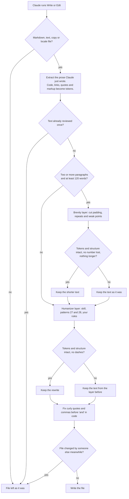
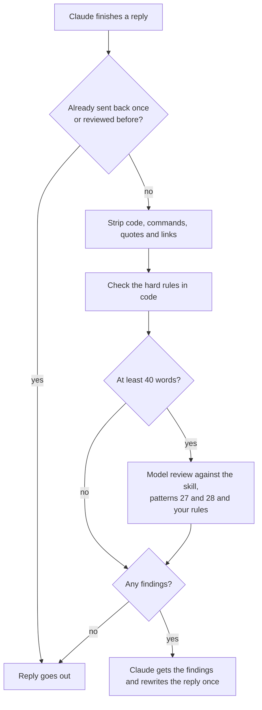

# Michael's Writing Hooks

Claude Code hooks for the prose Claude writes. After every Write or Edit, the prose in the file goes through two layers in order: brevity cuts what does not earn its place, then the humanizer removes AI writing tells. Before Claude sends its final reply, a Stop hook checks the reply for the same tells and sends it back once with notes when it finds any.

Only prose is touched. Code, links, URLs, quotations and Markdown structure are protected and checked after every rewrite, so a rewrite that breaks one is thrown away. In code files, only copy files (`copy.ts`, `*.copy.*` and a `copy/` directory) and locale files are read. Any failure leaves the file as it was.

## How it works

A file write:



A final reply:



A layer that fails or times out is skipped and the layers after it still run.

## Install

Python 3.9 or later and the `claude` CLI on your PATH.

```
/plugin marketplace add iMerica/writing-hooks
/plugin install writing-hooks@writing-hooks
```

The humanizer layer sends the [blader/humanizer](https://github.com/blader/humanizer) skill as its rulebook. This marketplace lists that skill too. The plugin declares it as a dependency, so installing writing-hooks installs it. If you already installed humanizer from its own marketplace, you now have two copies of the same skill. Uninstall `humanizer@humanizer`, because writing-hooks stops loading without its dependency.

## Layers

`LAYERS` in `humanizer_hook.py` is the stack. Claude Code runs matching hooks in parallel, so two hooks rewriting one file would race. Stacking therefore happens inside this one hook: each layer gets the previous layer's output, validated.

- **brevity** runs only on writing with two or more paragraphs and at least 120 words. It may cut padding, repeated ideas, recaps, setup and weak points. It never adds anything, never makes a segment longer and never drops a number or cuts a paragraph that holds one.
- **humanizer** runs the skill's patterns plus the ones in `EXTRA_PATTERNS` and the rules in `USER_RULES`.

To add a layer, write a system prompt, an `applies` check and a `valid` check, then add a `Layer` to the list.

## Rules

`USER_RULES` holds the hard rules, which override the skill: no em or en dashes, no curly quotes, no comma before "and" and no list ending on a bare comma. Curly quotes and commas before "and" are also fixed in code. A rewrite that contains a dash is rejected, so none of these depends on the model. `EXTRA_PATTERNS` adds two patterns to the skill's numbering: scripted relatability (27) and decorative specificity (28). Edit both to match your own style.

## Settings

Environment variables, all optional:

| Variable | Default | Meaning |
|---|---|---|
| `HUMANIZER_FILE_MODEL` | `claude-sonnet-5-5` | Model for the humanizer layer |
| `HUMANIZER_BREVITY_MODEL` | `claude-sonnet-5-5` | Model for the brevity layer |
| `HUMANIZER_STOP_MODEL` | `claude-haiku-5-5` | Model for the reply review |
| `HUMANIZER_EFFORT` | `low` | Effort for every model call |
| `HUMANIZER_BREVITY_MIN_WORDS` | `120` | Words before brevity runs |
| `HUMANIZER_FILE_MIN_WORDS` | `10` | Words before the humanizer runs |
| `HUMANIZER_STOP_MIN_WORDS` | `40` | Words before a reply is reviewed |
| `HUMANIZER_FILE_BUDGET` | `170` | Seconds for all layers on one write |
| `HUMANIZER_BREVITY_BUDGET` | `75` | Seconds for the brevity layer |
| `HUMANIZER_SKILL_PATH` | | A `SKILL.md` to use instead of the installed one |
| `HUMANIZER_STATE_DIR` | `~/.claude/state/humanizer` | Seen-text cache and error log |

Each piece of text gets one pass. Errors go to `errors.log` in the state directory.

## Tests

```
python3 -m unittest discover -s tests
```

The tests use a stand-in for `claude` and make no network calls.

## License

MIT. The humanizer skill is MIT licensed by Siqi Chen and is installed separately.
